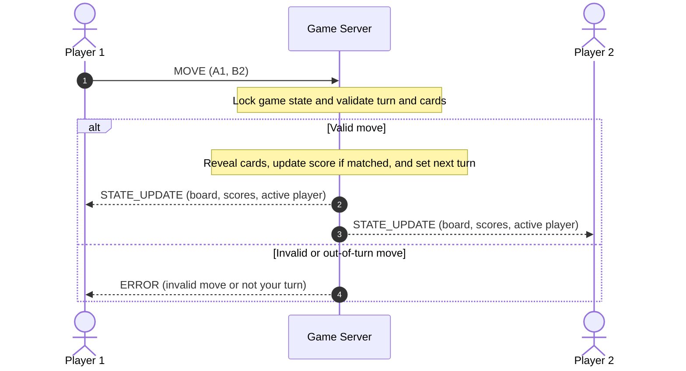

# Pet Memory Match Concurrency Design

## Concurrency Model

This game will use Python multi-threading. The server will make one thread for each connected client so both players can stay connected without blocking each other.

The server will use one `threading.Lock` to protect the board, matched cards, scores, active player, and connected-client list.

## Connection Lifecycle

1. The server starts one listening socket and waits for client connections.
2. When a client connects, the server accepts the socket, adds the client to the connected-client list, and starts that client's worker thread.
3. The worker thread receives and handles messages from that client while the game is running.
4. When two clients are connected, the server starts the game.
5. When a client sends `DISCONNECT`, reaches TCP EOF, or has a socket error, the server removes that client from the list and closes the socket.
6. If a player disconnects during a game, the other player wins by forfeit. The server then clears the game state and waits for new players.

## Locking

The same `threading.Lock` will protect the board, matched cards, scores, active player, and connected-client list.

A client thread will get the lock before checking or changing shared game data. Inside the lock, it will:

1. Check that the player is allowed to move.
2. Check that both card positions are valid and unmatched.
3. Update the board, score, and active player.
4. Make a copy of the updated game state for `STATE_UPDATE`.

The thread will release the lock before sending messages to clients. This keeps a slow client from blocking game-state updates.

The server will also use the lock when adding or removing a client from the connected-client list.

## Turn and Score Updates

After every valid move, the server sends the same updated board, score table, and active player to both clients. If the cards match, the active player gets one point and keeps the turn. If they do not match, the server hides the cards again and switches the turn.

## Scores

The server keeps scores in memory as one score for each player, starting at zero.

When a player finds a matching pair, the server updates that player’s score while holding the lock. The next `STATE_UPDATE` sends the updated score table to both players. `GAME_OVER` also includes the final scores.
