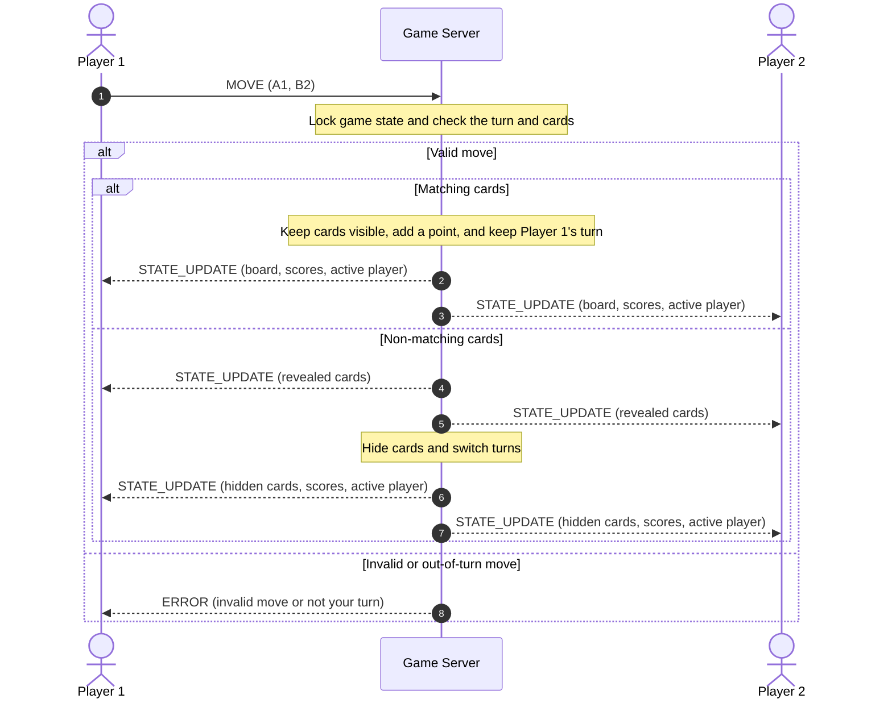

# Pet Memory Match Concurrency Design

## Concurrency Model

This game will use Python multi-threading. The server will start one thread for each player so both clients can stay connected and send messages without waiting on each other.

The server will use a lock for the game state, a lock for broadcasts, and a separate send lock for each client socket.

## Connection Lifecycle

1. The server starts a listening socket and waits for clients.
2. When a client connects, the server accepts the connection, adds that client to its list, creates a send lock for it, and starts a worker thread.
3. Each worker thread listens for messages from its own client while the game is running.
4. When two clients are connected, the server starts the game.
5. If a client sends `DISCONNECT`, reaches TCP EOF, or has a socket error, the server removes that client and closes the socket.
6. If someone disconnects during a game, the other player wins by forfeit. The server then clears the game and goes back to waiting for players.

## Locking

The game-state lock protects the board, matched cards, scores, active player, and client list.

Before a player’s move can change anything, that client’s thread gets the game-state lock. It checks that the move is allowed, checks both card positions, updates the board and score if needed, and makes a copy of the updated game state.

Each client has its own send lock. A thread gets that lock before sending a message so two threads cannot send mixed-up JSON data to the same client.

The broadcast lock keeps `STATE_UPDATE` messages in the right order. A thread gets the broadcast lock before it lets go of the game-state lock. It then sends the update to both players and releases the broadcast lock.

## Turn and Score Updates

After every valid move, the server sends the same game state to both players. If the cards do not match, both players see them first. The server then hides them and sends the next-turn update.

## Scores

The server keeps one score for each player, starting at zero.

When a player finds a matching pair, the server updates that score while the game-state lock is held. The next `STATE_UPDATE` sends the new score table to both players. `GAME_OVER` also includes the final scores.
